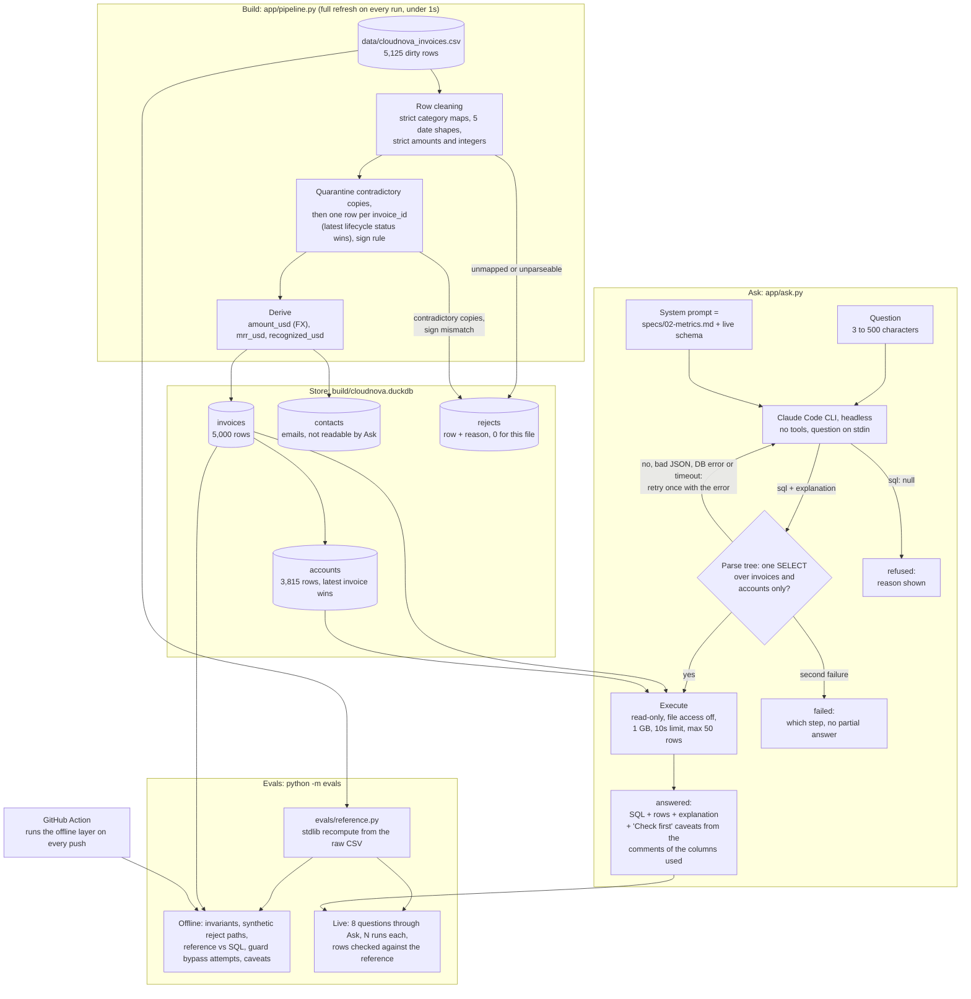

# Architecture

What is actually built, end to end. Every box maps to a file.

## Reading it

- **One direction of data flow.** Raw CSV to cleaned tables to answers. The question layer can only
  read `invoices` and `accounts`; it cannot write, reach the raw file, or read `contacts` and `rejects`.
- **Business rules sit in the store, not in the prompt.** `amount_usd`, `recognized_usd` and `mrr_usd`
  are columns, so the model's job is to pick and aggregate columns, not to re-derive revenue rules.
- **Warnings travel with the data.** A column or table comment can end in `Caveat: ...`. The guard
  already knows which columns a query touched, so those caveats are printed under the answer whatever
  the model wrote.
- **One glossary.** `specs/02-metrics.md` is read by people, drove the build, and is sent to the model
  verbatim. There is no second copy to drift.
- **Two independent implementations of the answers.** The SQL pipeline and `evals/reference.py` share
  no code. The evals pass only when they agree.
